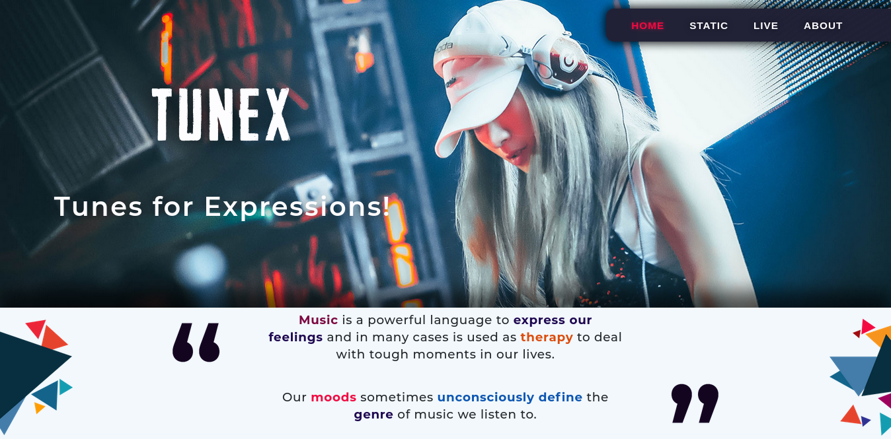

# TUNEX • Tunes for Expressions

> Real-time facial emotion recognition and personalized Spotify song recommendation engine.



TUNEX bridges computer vision with music streaming intelligence. It analyzes facial expressions from a live webcam feed or uploaded photos, classifies the emotional state into 7 psychological mood categories using a Deep Convolutional Neural Network (CNN), and streams personalized song recommendations directly from the user's linked Spotify account.

---

## ✨ Key Features (Refactored & Modernized)

- **🎧 Seamless Spotify Account Linking**:
  - Secure **Spotify OAuth2** Authorization Code flow with session management and automatic token refresh.
  - Users link their accounts with one click to unlock personalized recommendations.
- **📷 Client-Side HTML5 Webcam Streaming**:
  - Replaces obsolete server-side OpenCV hardware capture with in-browser `navigator.mediaDevices.getUserMedia()`.
  - Supports both **Manual Snapshot Scan** and **Continuous Live Scanning (2.5s)**.
- **🧠 7-Class Emotion Neural Network**:
  - OpenCV Haar Cascade frontal face detection extracts and normalizes the region of interest (ROI).
  - A lightweight 48x48 CNN model predicts probabilities across **Happy, Sad, Angry, Surprised, Afraid, Disgust, and Neutral**.
- **🎵 Modern Audio Playback**:
  - Upgraded to **Embedded Spotify Widgets** (`iframe`) with album art, track details, and instant streaming (replacing deprecated 30-sec preview URLs).
- **🎨 Cyber-Glassmorphic Dark Mode UI**:
  - Built with responsive Bootstrap 5, Outfit & Inter typography, animated equalizer, and neon mood accent styling.
- **⚡ Thread-Safe & Scalable**:
  - Clean separation into `ai_service` and `spotify_service` with zero mutable global variables and full environment variable (`.env`) support.

---

## 🎭 Supported Emotions & Audio Matching

| Emotion | Target Valence | Target Energy | Curated Spotify Soundscape |
| :--- | :---: | :---: | :--- |
| **Happy** 😄 | 0.85 | 0.80 | Uplifting pop, summer disco, upbeat dance hits |
| **Sad** 😢 | 0.20 | 0.30 | Melancholy indie, acoustic ballads, gentle piano |
| **Angry** 😡 | 0.30 | 0.90 | High-octane rock, heavy metal, raw punk energy |
| **Surprised** 😲 | 0.75 | 0.85 | Electrifying synthwave, hyperpop, energetic beats |
| **Afraid** 😨 | 0.35 | 0.45 | Calming ambient, grounding cinematic lo-fi |
| **Disgust** 😒 | 0.40 | 0.65 | Gritty 90s grunge, alternative rock, raw blues |
| **Neutral** 😐 | 0.50 | 0.50 | Lo-fi study beats, acoustic chillout, mellow flow |

---

## 🚀 Quickstart Guide

For step-by-step instructions on setting up your Spotify Developer credentials and running TUNEX, see **[Install.md](./Install.md)**.

```bash
# 1. Clone repository
git clone https://github.com/hp77-creator/TUNEX.git tunex
cd tunex

# 2. Set up virtual environment
python3 -m venv venv
source venv/bin/activate

# 3. Install requirements
pip install -r requirements.txt

# 4. Copy and configure .env
cp .env.example web/tun/.env

# 5. Run migrations & start server
cd web/tun
python manage.py migrate
python manage.py runserver
```

Visit **http://127.0.0.1:8000/** in your browser.

---

## 🧪 Testing

Run the automated test suite verifying computer vision inference, Spotify OAuth flows, and view endpoints:

```bash
cd web/tun
python manage.py test recognise
```

---

## 👥 Credits

Developed as a collaborative project by the DRISHTI-AI/ML Team.  
Enhanced and modernized with client-side webcam streaming, Spotify OAuth2 account linking, and a responsive glassmorphic UI.
